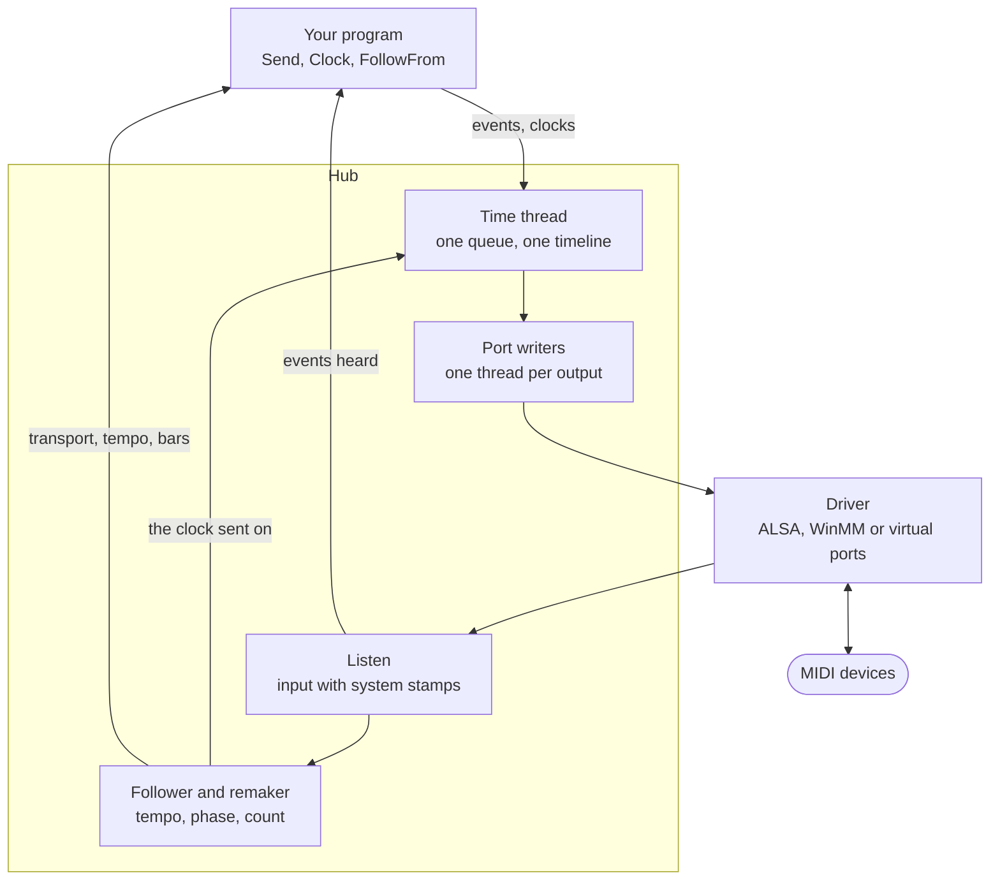
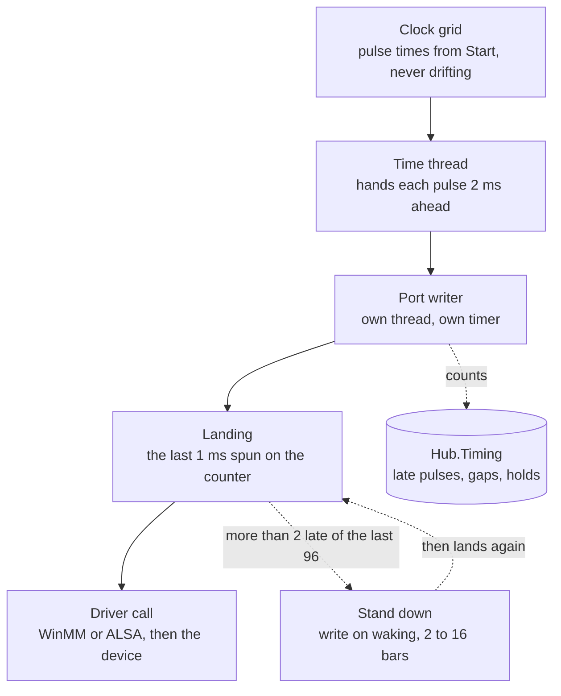

# How mydi works

mydi has two paths through one `Hub`. What a program sends goes down, through the time thread and a writer per port, to the system's
MIDI driver. What a device plays in comes back up with the system's own stamps, to the program or into the follower, which re-makes a
device's clock and sends it on. The decisions behind each part are in [docs/adrs](../adrs/README.md).

## The parts

- **Your program** builds the hub with `NewHub`: the ports it may use (`allowed`), where input goes (`listen`) and an owner for each
  send. `Release(owner)` ends every note that owner holds ([ADR-0002](../adrs/0002-events-ports-and-held-notes.md)).
- **The time thread** owns every timed write: the clocks' pulses and events with `at`, on one queue and one timeline. On Windows it
  runs at a priority the system serves on time (MMCSS "Pro Audio" and time-critical); on Linux on Go's timers at normal priority, for
  now. It never calls a driver ([ADR-0003](../adrs/0003-one-time-thread.md)).
- **The port writers**, one per output, make every write to the port (opening it is the hub's), so a driver that holds a write holds
  only its own port
  ([ADR-0006](../adrs/0006-a-writer-per-port.md), [ADR-0007](../adrs/0007-writes-handed-ahead.md)).
- **Listen** opens the inputs and hands on what they play, with the time it was read. An input being followed is read with the
  system's own stamps instead (WinMM's on Windows), which the follower fits its line on.
- **The follower** fits a line through a device's clock pulses to know its tempo and phase; **the remaker** sends that clock on to
  other ports, every pulse counted from Start to Stop ([ADR-0004](../adrs/0004-following-a-devices-clock.md),
  [ADR-0005](../adrs/0005-a-followed-clock-that-moves.md)).
- **The driver** is the machine's MIDI (`System`: ALSA's raw MIDI on Linux, WinMM on Windows) or `Virtual` ports of files.

## One clock pulse, from the grid to the device

- **The grid.** A clock's pulse times are counted from its Start (24 a quarter note), so a late pulse never moves the next one. A short
  stall is caught up, pulses never closer than a quarter interval; a stall of more than four pulses moves the grid on
  ([ADR-0003](../adrs/0003-one-time-thread.md)).
- **Handed ahead.** The time thread gives each pulse of a port's own clock to its writer 2 ms before its time, with that time, so the
  hand-off is never on the write's path. A followed clock's pulses are handed at their time instead, since the follower decides each one
  only when it is due ([ADR-0007](../adrs/0007-writes-handed-ahead.md)).
- **The landing.** The writer sleeps on its own timer (on Windows a high-resolution waitable timer, on Linux Go's) until 1 ms before
  the time, then spins on the system's counter for the rest, so the write lands on time: mydi's one deliberate spin, a millisecond long.
  On a loaded machine that spin is itself taken off the processor, so a writer that lands late more than 2 times in its last 96 stands
  down for 2 bars, writing on waking; a stand-down that follows another at once lasts twice as long, up to 16 bars
  ([ADR-0008](../adrs/0008-a-landing-that-stands-down.md)).
- **Counted.** Every pulse is counted against its place: more than 1 and 5 ms late, the longest gap, writes a driver held, stand-downs.
  `Hub.Timing` answers them, and `mydi timing` prints them ([the measuring guide](measuring.md)).
- **A driver that holds.** If the driver holds a write, only that port waits; when it returns, a short hold is caught up and a long one
  resynchronised, and a note off is never dropped ([ADR-0006](../adrs/0006-a-writer-per-port.md)).
